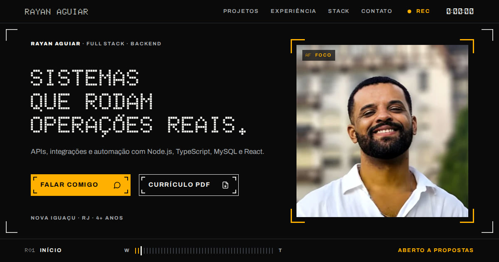

# Portfólio · Rayan Aguiar

Portfólio de Rayan Aguiar, desenvolvedor full stack com foco em backend. O site é desenhado como o visor de uma filmadora: cada projeto é um clipe, a experiência é o log da fita e a barra W→T indica se você está na visão geral ou no detalhe.

**Acesse:** https://portfolio-eta-seven-32.vercel.app

<p align="center">
  
</p>

## O que tem

- **Projetos:** 11 projetos atuais (APIs, pipelines em Go, extensões de Chrome, apps mobile, 3D na web) e um arquivo com os antigos. Os projetos privados aparecem com diagramas de arquitetura, sem citar empresas.
- **Página de cada projeto** (`/projetos/:slug`): problema, o que foi construído, arquitetura, stack e links.
- **Experiência:** log de 2022 a 2026 com os números reais de cada posição.
- **Contato:** WhatsApp, e-mail, LinkedIn, GitHub e currículo em PDF.

## Stack

- React 18 + TypeScript + Vite
- React Router (páginas de projeto carregadas sob demanda)
- CSS próprio, sem framework de UI
- Fontes self-hosted: Doto (títulos), DSEG14 (contadores) e Archivo (texto)
- Ícones: Lucide

## Rodando localmente

```bash
npm install
npm run dev
```

## Onde editar o conteúdo

| Arquivo | Conteúdo |
|---|---|
| `src/data/site.ts` | Nome, contatos, status e stack |
| `src/data/projects.ts` | Projetos, diagramas de arquitetura e arquivo |
| `src/data/experience.ts` | Experiências e formação |
| `public/docs/curriculo-rayan-aguiar.pdf` | Currículo para download |

## Licença

MIT. A fonte DSEG14 é distribuída sob a SIL Open Font License (`src/assets/fonts/DSEG-LICENSE.txt`).
